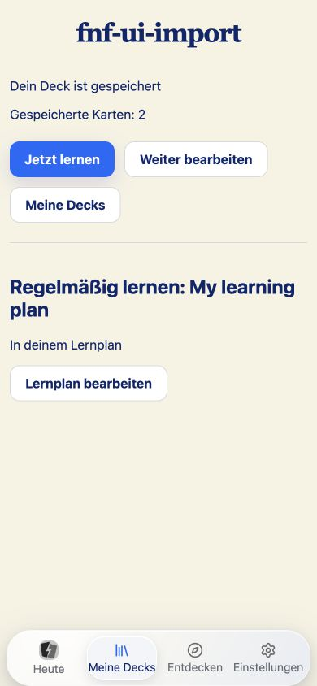
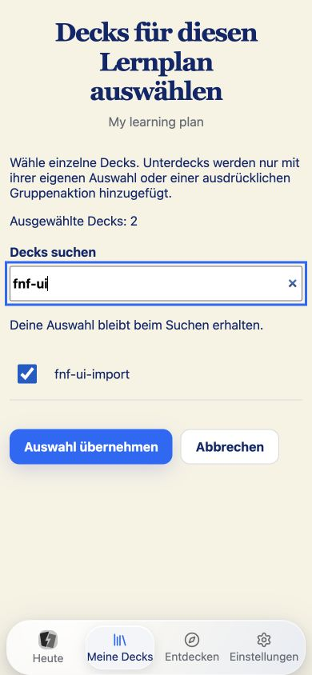

# Nachprüfung der weiteren UI-Punkte – 27. Oktober 2026

Status: Browserabläufe und automatisierte Prüfung bestanden; native
Bedienprüfung weiterhin ausdrücklich vertagt. Keine Releasefreigabe.

## Geschlossene Lücken

- Durchsuchbare Planauswahl mit erhaltener Auswahl, sichtbarem Unterdeckumfang
  und ausdrücklichem Umfang der Gruppenaktion bei gefilterten Ergebnissen.
- Übernehmen und Abbrechen führen zu Heute oder zum Abschluss des bearbeiteten
  Decks zurück. Andere/externe Rücksprungziele werden verworfen.
- „Fertig“ führt zum gespeicherten Deck mit Kartenzahl, Lernstart und aktivem
  Plan. Ein offener Entwurf wird über „Speichern & fertig“ erst sicher
  gespeichert. Fehler behalten den Entwurf und führen nicht zum Abschluss.
- Nach Import derselbe konzentrierte Abschluss; Referenzinhalte führen zum
  Nachschlagen und bieten keine neue Planzuordnung an.
- Frage-/Antwortdarstellung unter Lernen, Rechtliches unter Hilfe,
  iCloud-Zusatzwerkzeuge nachgeordnet. Wiederherstellung hat eine sichtbare
  Aktion statt eines zusätzlich vom Screenreader angebotenen Datei-Buttons.
- Kompakte Aufgabenüberschriften und kürzere, kontextbezogene Hinweise.
  Ladefehler in Bibliothek und Deckeditor bieten eine erneute Abfrage an.

## Reale Browserabläufe

Getrennte Prüfbibliothek auf `ui-review-20261026.localhost:3000`; keine echten
Nutzerinhalte verändert.

1. Von Heute zur Planwahl, gefiltertes Deck zusätzlich angewählt und
   abgebrochen: Rückkehr zu Heute, weiter zwei vorgesehene Karten.
2. Erneut ausgewählt und übernommen: Rückkehr zu Heute, jetzt drei vorgesehene
   Karten. Damit ist die Wirkung einer bewussten Auswahl sichtbar.
3. Bestehendes Deck fertiggestellt: Abschluss zeigt eine gespeicherte Karte.
4. Weiter bearbeitet, neue Frage und Antwort eingegeben, „Speichern & fertig“:
   Abschluss zeigt zwei gespeicherte Karten. Neuladen erhält diesen Bestand.
5. Vom Deckabschluss zur Planwahl und zurück: derselbe Deckabschluss erscheint
   erneut. Die Filteransicht behält die Auswahl auch außerhalb der Treffer.
6. Einstellungen geprüft: Lernoption im Lernbereich, Datenaktionen und Hilfe
   getrennt; genau eine Wiederherstellungsaktion im zugänglichen Baum.

Hell und dunkel, normale und größte App-Schrift, 390 × 844 und 1440 × 900
wurden gerendert geprüft. Bei 390 × 520 lässt sich zu den Planaktionen scrollen
und per Tab/Shift-Tab navigieren; beide Aktionen bleiben über der Navigation.
Gemessen: Übernehmen y=238,03–282,03; Abbrechen y=292,03–336,03;
Navigation beginnt erst bei y=441,14. Beide Buttons sind 44 px hoch.

[layout.json](layout.json): fünf Szenarien mit sichtbaren Hauptaktionen und
Navigation bestehen das Überlappungsskript; Dokumentbreite entspricht dem
Viewport. [selection-short-actions.json](selection-short-actions.json)
dokumentiert die niedrige, gescrollte Ansicht. [contrast-results.json](contrast-results.json)
enthält sieben gemessene Farbpaare der Auswahl, alle über ihrem Grenzwert.
Der globale Scanner meldet 0 statische Fehler und 326 Review-Stellen; das ist
keine vollständige Kontrastfreigabe aller bestehenden Oberflächen.

## Exakter Commit-Inhalt

Der vorgesehene Index wurde in ein separates Verzeichnis exportiert, ohne die
älteren Änderungen an Hilfe, Musik, Zwischenablage und anderen Arbeiten. Vier
von mehreren Arbeiten berührte Dateien wurden für den Index dreiseitig
zusammengeführt; der vollständige Arbeitsbaum blieb erhalten. Die exportierten
Dateien wurden gegen den Index geprüft. Abhängigkeiten wurden lokal übernommen,
geteilte Pakete anschließend im Export frisch gebaut.

Bestanden: 1.992 Tests im Index-Export (Web 1.040, API 312, Domain 276,
Plattformpaket 219, Apple 35, Scheduler 11, Sync 99). Die abweichende Summe zur
früheren Prüfung entsteht durch die zusätzlich geprüften UI-Fälle und den
bewussten Ausschluss fremder, noch uncommitteter Tests. Wiederholungen werden
nicht addiert.

Apple-Simulator-Debugbuild, Web-Produktionsbuild und abschließende Web-/API-
Typprüfung aus dem Export bestanden. Nach der letzten Rückkehrkorrektur sämtliche
1.040 Webtests nochmals bestanden. UI-Sprachprüfung und Versionsprüfung bestanden.
[integrity.json](integrity.json): 54 Scheduler-/Sync-/Cloud-Quelldateien
bytegleich zum ursprünglichen Ausgangsstand; zwei Paketmanifest-Dateien haben
nur die erforderliche Versionsänderung. 13 Methoden-/Swift-Vergleiche bestätigen
unveränderte Queue-, Bewertungs-, Persistenz- und Cloud-Logik.

Produktversion: 0.5.1, Apple-Uploadzähler 4. Ein lokaler Commit; kein Push oder
Deploy. Die vorhandenen fachlichen Referenzregeln bleiben erhalten, ebenso die
Wiedergabe alter Audiomedien nach dem vollständigen Ausbau des Optimizers.

## Offen

Native Bedienprüfung, echte Bildschirmtastatur und VoiceOver bleiben wie zuvor
vereinbart später. Der Browser hat den Zoom-Tastaturbefehl nicht umgesetzt
(unverändert 1440 × 900, devicePixelRatio 1); echter 200-Prozent-Zoom bleibt
unbestätigt. Reflow und größte App-Schrift wurden separat geprüft und werden
nicht als Browserzoom ausgegeben. Karten-/Erkunden-Varianten sowie reale
Erstnutzertests bleiben die im ursprünglichen Bericht genannten Abnahmen.
Keine Cloudaktivierung, kein Mehrgerätetest und keine destruktiven Aktionen
mit echten Nutzerdaten durchgeführt.

