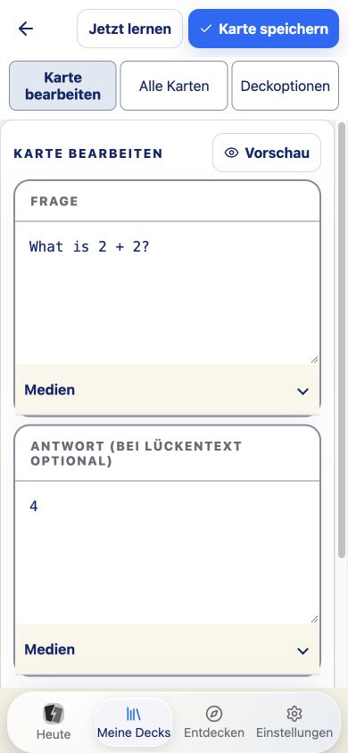
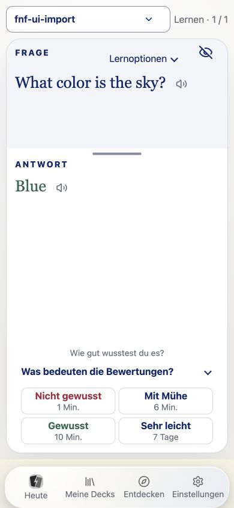
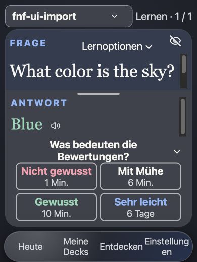

# UI-Vereinfachung: Umsetzungsprüfung vom 27. Oktober 2026

Status: Browser-Kernabläufe und automatisierte Regression bestanden. Native
Bedienprüfung auf ausdrücklichen Wunsch später. Keine Releasefreigabe.

Die vollständige Zuordnung aller 22 Befunde und ihrer Lösungen steht in
[ui-improvements.md](../../../../../ui-improvements.md#10-umsetzung-vom-27-oktober-2026).
[ADR 0058](../../../../architecture/decisions/0058-task-focused-ui-and-audio-retirement.md)
dokumentiert die vollständige Stilllegung der Audiooptimierung und den Erhalt
bereits gespeicherter Medien.

## Tatsächlich ausgeführte Kernabläufe

Eine eigene Browser-Origin `ui-review-20261026.localhost:3000` trennte die
Prüfdaten von vorhandenen Nutzerbibliotheken. Kein echtes Nutzerset und kein
bestehender Lernstand wurde verändert.

- Leere Bibliothek führt zu Entdecken oder eigener Erstellung.
- Deck benannt, erste Frage/Antwort gespeichert, zweite Karte mit „Speichern &
  nächste“ angelegt; beide Karten nach Neuladen vorhanden.
- Vor der Zuordnung: Deck vorhanden, Plan leer, Aufforderung zur Deckauswahl.
- Auswahl angehakt und abgebrochen: Plan unverändert. Erneut ausgewählt und
  übernommen: regulärer Plan zeigt zwei neue Karten.
- Zwei Karten regulär mit GOOD bewertet. Erst danach Abschluss mit zwei
  Bewertungen. Nach Neuladen bleibt der Tagesabschluss bestehen.
- Freie Übung zeigt ihren Modus und „Weiter“ anstelle der Scheduler-Ratings.
  Die Bibliothek benennt den Bestand ausdrücklich als zuvor gelernte Karten.
- Gemeinsame Dateiauswahl erkennt CSV; Import einer Karte, Rückkehr zum Editor
  und Neuladen zeigen die gespeicherte Karte. Zusätzlich Verhaltenstests für
  gültige Textvorschau und ungültige Zeilen mit unverlorener Eingabe.
- Deutsch/Englisch, hell/dunkel, normale und größte App-Schrift; volle
  Editorbreite auf 360/390 CSS-Pixeln; reguläre Bewertung und freie Übung auch
  bei nur 520 CSS-Pixeln Höhe.

## Gerenderte Messungen

[overlap.json](overlap.json) wurde mit dem Projekt-Abstandsskript geprüft:
alle neun gespeicherten Szenarien bestanden. Absichtliche Überdeckung von
Fragetext durch das geöffnete Optionen-Popup ist explizit markiert. Auswahl,
Bewertungen und Frage-Schalter bleiben erreichbar.

[study-layout.json](study-layout.json) enthält reale Browsermaße. Das
Kartenlayout-Skript besteht für jede gespeicherte Lernansicht. Beispiele:

| Szenario                             | Viewport   | Karte        | Anteil Breite / Höhe | Padding | Dokumenthöhe |
| ------------------------------------ | ---------- | ------------ | -------------------- | ------- | ------------ |
| Freie Übung, dunkel, größte Schrift  | 390 × 520  | 370 × 390,25 | 94,9 % / 75,05 %     | 10 px   | 520 px       |
| Freie Übung, dunkel, größte Schrift  | 390 × 844  | 370 × 674,13 | 94,9 % / 79,87 %     | 14 px   | 844 px       |
| Breite Ansicht, größte Schrift       | 1440 × 900 | 1356 × 820   | 94,2 % / 91,11 %     | 14 px   | 900 px       |
| Vier Ratings, hell                   | 390 × 844  | 370 × 688,80 | 94,9 % / 81,61 %     | 14 px   | 844 px       |
| Vier Ratings, dunkel, größte Schrift | 390 × 520  | 370 × 392    | 94,9 % / 75,38 %     | 10 px   | 520 px       |

Die kurze Antwortansicht erhält mindestens 110 px für die Frage. Im letzten
Durchlauf waren 68 px für den eigentlichen Fragetext verfügbar: eine volle Zeile
der größten Lernschrift bleibt sichtbar. Längerer Inhalt scrollt innerhalb der
Karte. Die Bewertungshilfe öffnet ein begrenztes, scrollbar lesbares Popup und
verdrängt Frage/Antwort nicht aus dem Layout.

Der Editor zeigt bei 360 px Breite ein 328 px breites Titelfeld; bei 390 px sind
Frage/Antwort je 341 px breit. Textfelder starten mobil mit 160 px Höhe und
bleiben vergrößerbar. Dokumentbreite entspricht jeweils dem Viewport.

## Lesbarkeit

[contrast.json](contrast.json) enthält gerenderte Farbwerte aus Einstellungen,
Editor und Lernansicht. [contrast-results.json](contrast-results.json) prüft 20
verschiedene Vordergrund-/Hintergrundpaare: kein gemessenes Paar unterschreitet
seinen Grenzwert. Beispiele (ungerundete Werte im JSON):

| Element                                 | Paar                          | Verhältnis |
| --------------------------------------- | ----------------------------- | ---------- |
| Primärbutton                            | Weiß auf `#0f6afa`            | 4,706 : 1  |
| Deaktivierter Button                    | `#50586d` auf `#d8dae3`       | 5,091 : 1  |
| Hilfstext hell                          | `#666b75` auf Weiß            | 5,350 : 1  |
| Hilfstext auf hellem Seitenhintergrund  | gerenderter sRGB-Hintergrund  | 4,81 : 1   |
| Schlechtestes gemessenes dunkles Rating | gerenderte Farben, siehe JSON | 4,97 : 1   |

Transparente Texte wurden gegen ihren nächsten gerenderten deckenden
Hintergrund geprüft. Das ersetzt keine vollständige Pixelprüfung sämtlicher
Verläufe, Zustände und Plattformen. Der globale statische Scanner meldet 0 Fehler
und weiterhin 326 Review-Stellen einschließlich unveränderter Admin-Oberfläche.

## Regression und geschützte Fachlogik

[verification.json](verification.json): 1.990 unterschiedliche Tests bestanden,
weitere 22 gezielte Wiederholungen nach den letzten UI-Korrekturen ebenfalls.
TypeScript, Sprachprüfung, Shellsyntax und finaler Apple-Simulator-Debugbuild
bestanden. Das Dockerimage wurde nicht neu gebaut; dort entfällt lediglich die
nun ungenutzte FFmpeg-Runtimeabhängigkeit. Der lokale Start verlangt FFmpeg und
FFprobe ebenfalls nicht mehr. Das separate Soundfont-Erzeugungswerkzeug darf
FFmpeg weiterhin verwenden.

[integrity.json](integrity.json): 56 geschützte Dateien unter Scheduler, Sync und
Cloud entsprechen bytegenau dem gesicherten Arbeitsbaum vor dieser Umsetzung.
Der AST-Vergleich bestätigt unveränderte Queue-/Tages-/Bewertungsmethoden,
Fortschrittsreset, Strategie-Update, versionierte Planpersistenz und vorhandene
Medienauswahl/-bereinigung. Native Identity-/CloudKit-Bausteine hinter dem
entfernten Audioplugin sind ebenfalls unverändert.

Vorhandene, andere Änderungen blieben erhalten. Kein Commit, Push oder Deploy.
Der temporäre Entwicklungsserver wurde beendet und ausschließlich der neu
angelegte Simulator entfernt; vorhandene Simulatoren blieben unangetastet.

## Offen

- Native Bedienprüfung ausdrücklich später; physisches iPhone/iPad, echte
  Bildschirmtastatur, VoiceOver und größte systemseitige Schrift fehlen.
- 200-Prozent-Browserzoom sowie Kartenmaterial mit Frage/Antwort, Erkunden und
  allen Kartenmodi wurden in dieser Umsetzung nicht gerendert abgenommen.
- Keine vollständige Sprach-/Gerätematrix, kein repräsentativer Erstnutzertest.
- Kein Live-Mehrgeräteabgleich, keine Cloudaktivierung, kein destruktiver
  Lösch-/Resetdurchlauf und keine Backupwiederherstellung mit echten Nutzerdaten.
- Vollständiger APKG-/FNF-Browserdurchlauf fehlt; automatisierte Import-,
  Inhaltsvalidierungs-, Persistenz- und Konflikttests bleiben bestanden.

Diese Grenzen bleiben ausdrücklich offen. Größere Schrift und Simulatorbuild
sind kein Ersatz für physische Geräte- oder Releaseabnahme.

## Screenshots

