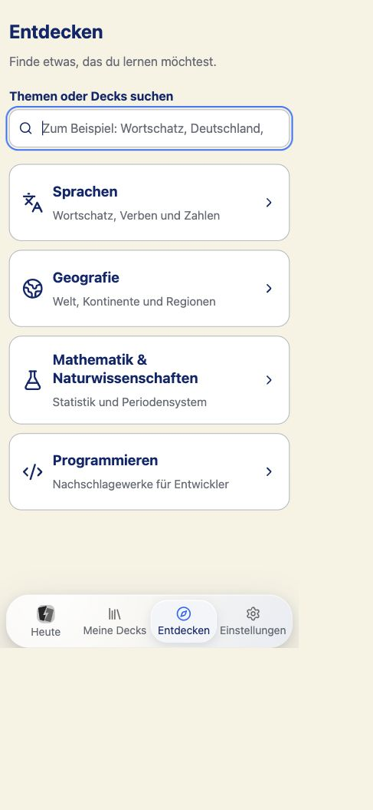

# Entdecken nach Kategorien

Stand: 29.–30. Oktober 2026. Auftrag: den vorgeschlagenen Entdecken-Umbau unter
`!!` umsetzen und prüfen. Kein Commit, Push, Upload oder Deployment.

## Ergebnis

Die Startseite zeigt Suche und vier Kategorien: Sprachen, Geografie,
Mathematik & Naturwissenschaften und Programmieren. Erst nach der Auswahl
erscheinen kompakte Angebote mit einer Aktion „Ansehen“. Die Detailseite zeigt
Umfang, enthaltene Sprachen und echte Karten aus dem signaturgeprüften Katalog.
Hinzufügen erfolgt ausdrücklich; installierte Inhalte bieten „Öffnen“.
Aktualisieren wird nur als ausführbare Aktion angeboten.

- Geografie beginnt mit Welt und sechs Kontinenten. Länder und Regionen sind
  über die Suche sowie unter ihrem Kontinent erreichbar. Weitere Unterdecks
  werden nur nach ausdrücklicher Auswahl einbezogen; die bestehenden
  Installationsregeln für übergeordnete Decks bleiben bestehen.
- Nur Sprachen zeigt einen Sprachfilter. Er berücksichtigt auch die 35
  vorhandenen Zahlensprachen. Der Filter verkleinert das installierte Paket
  nicht; der vollständige Umfang steht auf der Detailseite.
- „Zahlen üben“ öffnet seine bestehende Einrichtung erst nach Auswahl.
- FNF-/JSXGraph-/Mermaid-/ABC-Beispiele sind unter
  `/app/help?section=examples` erreichbar. Der alte Autoren-Anker leitet dorthin
  um. Die Entwickler-Referenz bleibt unter Programmieren.
- Die Vorschau schreibt keine Bewertungen. Wortschatz zeigt ein tatsächliches
  Sprachpaar, sprachspezifische Sammlungen passende Beispiele und Referenzen
  direkt ihren Inhalt. Die Autorenhilfe zeigt grafische Beispiele statt
  Einleitungskarten. Bestehende sichere Renderer bleiben zuständig.
- Eine Erfolgsmeldung erscheint nach erfolgreicher lokaler Installation und
  verschwindet beim Wechsel zu einer anderen Aufgabe. Ein anschließender
  Metadaten-Ladefehler löscht den bestätigten Installationserfolg nicht.
- Die Hilfe beschreibt die neuen Einstiege. Die veraltete Aussage zur
  AAC-Neukodierung importierter Audiodateien ist entfernt.

## Verifikation

| Prüfung                                   | Ergebnis                                                                                                                                                                                                                                                                             |
| ----------------------------------------- | ------------------------------------------------------------------------------------------------------------------------------------------------------------------------------------------------------------------------------------------------------------------------------------ |
| Web-Regression                            | 1.076 unterschiedliche Tests abgedeckt: 1.073 im Gesamtlauf; der Start eines Workers für `native-study-badge.test.ts` schlug mit Timeout fehl. Dessen drei Tests bestehen separat in 264 ms. Keine Testzeitlimits oder Badge-Logik geändert.                                         |
| Abschließende gezielte Tests              | 41 bestanden, einschließlich Kategorien, Länder-/Werkzeugsuche, Sprachfilter, realen Vorschaukarten, Sprachpaaren, Referenzen, Installationsbestätigung, Wiederholen, explizitem Geografie-Umfang, Rücknavigation und Hilfe. Diese Tests werden nicht zur obigen Gesamtzahl addiert. |
| Apple-Hülle / i18n                        | 37 / 18 Tests bestanden.                                                                                                                                                                                                                                                             |
| Web-Produktion / TypeScript               | Build und Typecheck bestanden.                                                                                                                                                                                                                                                       |
| i18n, Markenassets, Version, Formatierung | Prüfungen bestanden. Produktversion bleibt 0.5.2.                                                                                                                                                                                                                                    |
| Inhaltssicherheit                         | Projektscanner bestanden. Vorschauen verwenden den bestehenden Signaturprüfer und die vorhandenen sicheren Inhaltsrenderer; keine zusätzliche HTML- oder Skriptausführung.                                                                                                           |
| iOS                                       | Unsigned `TestFlight`-Gerätebuild für `generic/platform=iOS` bestanden. Technische Apple-Buildnummer 5, Marketingversion 0.5.                                                                                                                                                        |
| Bundle / Icon                             | Alle 160 Dateien stimmen zwischen portablem Bundle, Xcode-Projekt und gebauter App überein. Icon-Audit des kompilierten Assetkatalogs bestanden. Kein Upload. Siehe [apple-bundle.json](apple-bundle.json).                                                                          |
| Scheduler / Sync / Katalog                | Keine Änderungen an Domain, Scheduler, Sync, Plattform-Synchronisation oder signierten Katalogdateien. Bestehende Medien- und Icon-Korrekturen bleiben erhalten.                                                                                                                     |

Reale Bedienprüfung im Browser auf einer eigenen lokalen Testbibliothek:
Grundwortschatz ansehen, Antwort zeigen, hinzufügen, öffnen und nach erneutem
Laden wieder öffnen; globale Deutschland-Suche mit erhaltenem Suchbegriff beim
Browser-Zurück; Geografie-Kartenvorschau und Hinzufügen eines Länderangebots; Sprachfilter Japanisch; Zahlen-Einrichtung;
Entwickler-Referenz und Autorenhilfe; leere Suche; simulierter Katalogfehler mit
Wiederholen auf getrenntem lokalem Testserver. Keine Lernbewertung und keine
Cloudaktivierung. Die Bibliothek des installierten Produkts wurde nicht benutzt.

## Gerenderte Darstellung

Geprüfte tatsächliche CSS-Viewports: 390 × 844, 390 × 520 und 1.440 × 900.
Heller und dunkler Modus sowie normale und größte App-Schrift wurden geprüft.
Messwerte stehen in [rendered-measurements.json](rendered-measurements.json).
Der gemessene Dokumentinhalt überschreitet die jeweilige Viewportbreite nicht.

Lange Katalogseiten scrollen im vorhandenen App-Inhaltsbereich. Teilweise am
unteren Rand sichtbare Angebote in frühen Messungen sind normale Scrollzustände.
Die Prüfung der letzten Aktionen erfolgt zusätzlich nach Scrollen zum Ende;
die ursprünglichen Rechtecke bleiben zur Nachvollziehbarkeit erhalten. Das
Überlagerungsskript prüft gezielt die vollständig sichtbaren Bediengruppen und
deren Abstand zur mobilen Navigation; es wird nicht auf außerhalb des
Scrollausschnitts liegende Dokumentabschnitte angewandt. Alle sechs gezielten
Szenarien bestehen: [Messungen](overlap-measurements.json),
[Ergebnis](overlap-results.txt). Der Abstand der letzten Kategorie zur Navigation
beträgt mit großer Schrift am Seitenende 74,38 px (844 px Höhe) bzw. 51,26 px
(520 px Höhe). Nach Installation und Rückkehr zur Übersicht beträgt er mit
normaler Schrift 110,08 px. Tab führt von der Suche zur ersten Kategorie mit
sichtbarer blauer Kontur; siehe [Tastaturfokus](keyboard-focus.json).

Die 49 gemessenen Text-/Hintergrundpaare bestehen, einschließlich Fehlertext,
Metadaten und deaktivierter Vorschauaktionen. Der kleinste Kontrast beträgt
**4,706:1** (Weiß auf dem blauen Hauptbutton). Einzelwerte:
[contrast-results.json](contrast-results.json), [rendered-colors.json](rendered-colors.json).
Der Lesbarkeitsscanner meldet 0 Fehler und 336 manuell zu prüfende Stellen im
Gesamtprojekt; das ist keine pauschale Freigabe aller bestehenden Oberflächen.
Die neuen Aktionsflächen haben mindestens 44 CSS px Sollhöhe; einzelne
Rechtecke ergeben beim Browser-Zoom Subpixelwerte von 43,994 px.

Während der Prüfung behoben: fehlende Hauptbutton-Stilklasse, gleiche Sprache
auf beiden Seiten der Wortschatzvorschau, unpassende Sprache der Verbvorschau,
unnötiger Antwortbutton bei Referenzen, unklare Rücksprungbeschriftung sowie
eine auf der Kategorienübersicht stehenbleibende Installationsmeldung.

Weitere Ansichten: [große Schrift](categories-mobile-large.png),
[dunkler Desktop](categories-desktop-dark.png),
[kurzer dunkler Bildschirm](categories-short-dark.png),
[Hinzufügen](added.png), [Autorenhilfe](author-help.png),
[Katalogfehler](catalog-error-dark.png).

## Offene Abnahme und Freigaben

- Native Bedienprüfung im iOS-WebView, auf iPhone/iPad und als kompatible
  iOS-App auf dem Mac: **offen**, vom Nutzer zuvor auf später verschoben.
  Der erfolgreiche Gerätebuild ersetzt diese Prüfung nicht.
- VoiceOver, echte Bildschirmtastatur und echter 200-Prozent-Browserzoom:
  **offen**. Die größte App-Schrift ersetzt diese Prüfungen nicht.
- Neues Signieren, Archivieren, Hochladen und Kontrolle in App Store Connect
  übernimmt der Nutzer. Das Portal-Ergebnis des Icons wurde nicht neu geprüft.
- Der öffentliche Releasecheck meldet weiterhin acht bestehende Blocker:
  Produktionslogs und Aufbewahrung; Löschung/Backup-Ablauf alter Daten;
  netcup-AVV; Unternehmensstatus; Steuerkennungen; EU-DSA-Händlerstatus;
  Minderjährigen-/Store-Altersrichtlinie; qualifizierte Prüfung der Rechtstexte.
  Dieser UI-Auftrag ändert diese Gates nicht und erteilt keine öffentliche
  Releasefreigabe.

Web-Bedienabläufe und lokaler Build: **bestanden**. Native und öffentliche
Freigabe: **offen**.
