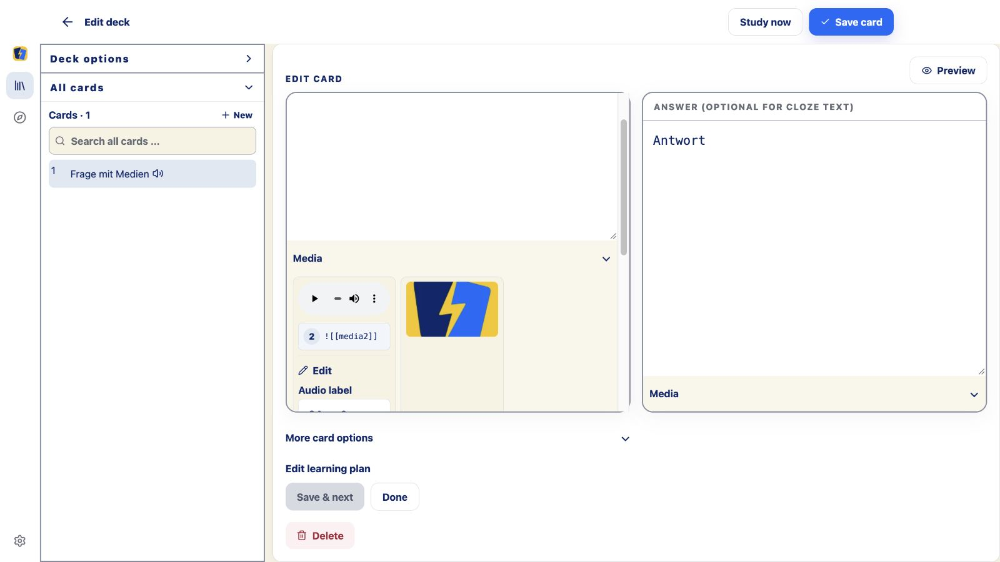

# Medienkarte lässt sich nicht speichern – 29. Oktober 2026

## Ursache und Korrektur

Der gemeldete Fehler wurde im realen Browserablauf mit Bild und Audio
reproduziert. Ein neuer Audioblock enthielt das optionale Feld
`transcript: undefined`. Auch das Leeren eines Transkripts erzeugte diesen Wert.
Die lokale Datenhaltung lehnt solche Werte in ihrem kanonischen JSON-Payload
absichtlich ab. Der Fehler wurde anschließend pauschal als Netzwerkfehler
ausgegeben. Netzverfügbarkeit war nicht die Ursache.

Der Medieneditor lässt fehlende optionale Angaben jetzt vollständig weg.
Das gilt für neue/ersetzte Medien und das Leeren eines Transkripts. Die
strenge Payload-Prüfung bleibt unverändert. Lokale Speicherfehler werden
nicht mehr pauschal mit einer Aufforderung zur Netzprüfung erklärt.
Entwürfe und stabile Karten-/Medienidentitäten bleiben beim fehlgeschlagenen
Speichern erhalten. Medienvalidierung, Outbox, Scheduler und Synchronisationslogik
wurden nicht verändert.

Für einen noch im alten Build offenen Entwurf wurde ein Rettungsweg geprüft:
Audio → Edit → Transcript (optional) sinnvoll ausfüllen → erneut speichern.
Das funktioniert ohne Neustart und ohne erneutes Hinzufügen der Medien.
Im korrigierten Build darf dieses Feld leer bleiben.

## Verifikation

- Zwei neue Verhaltenstests verwenden den echten Medieneditor und den echten
  lokalen Speicher mit IndexedDB. Sie reproduzierten vor der Korrektur beide
  Fehler: Bild + Audio ohne Transkript an einer bestehenden ABC-Referenzkarte
  sowie das Leeren eines bereits gespeicherten Transkripts. Beide bestehen.
  Kartentext, Medienreferenzen und vollständige Bild-/Audiobytes werden nach dem
  Speichern erneut gelesen; eine dauerhafte Outbox wird geprüft. Nur das von
  jsdom nicht unterstützte Bild-/Audiodekodieren ist in diesen Tests ersetzt.
- Im realen Browser wurden die Dateien tatsächlich validiert und dekodiert.
  Der ursprüngliche Fehler erschien mit Bild und Audio. Der Rettungsweg im
  alten Bundle funktionierte. Nach Laden des korrigierten Bundles konnte das
  Transkript geleert und die Karte gespeichert werden. Nach erneutem Neuladen
  blieb das Transkript leer; Bild und Audio waren wieder geladen: Bild
  192 × 192 px, Audio 4,838889 s, `readyState=4`. Getrennte Prüfbibliothek auf
  `127.0.0.1:38762`, ausschließlich Testdateien aus dem Repository.
- Web: **1.060**, Plattformpaket: **219**, Sync: **99**, Apple-Hülle: **37**,
  i18n: **18** Tests bestanden; **1.433 unterschiedliche Tests** insgesamt.
  Ein unveränderter Cloud-Starttest überschritt im ersten parallelen Gesamtlauf
  sein Zeitlimit. Gezielte Wiederholung und vollständiger Weblauf mit zwei
  Workern bestanden. Keine Zeitlimits oder Produktionslogik dafür geändert.
- Web-Typprüfung, UI-Sprachprüfung, Formatierung, Inhalts- und
  Synchronisations-Schutzprüfung sowie `git diff --check` bestanden.
- Apple-Bundle frisch gebaut und nach Xcode kopiert. Debug-iOS-Gerätebuild
  ohne Signierung bestanden. [Bundlevergleich](apple-bundle.json) bestätigt
  identische JS-Dateien im portablen Build, Xcode-Projekt und gebauten App.

Keine Versionserhöhung oder Commit unter `!!`. Aktuelle Produktversion bleibt
0.5.2, Apple-Build 5. Installation und Verteilung per Xcode bleiben beim Nutzer;
kein Rollout durchgeführt. Der physische iPhone-/iPad-WebView und natives
SQLite wurden in diesem Fix nicht praktisch neu abgenommen. Die Ursache liegt
vor dem plattformspezifischen Schreiben im gemeinsam genutzten Speicherpfad.

