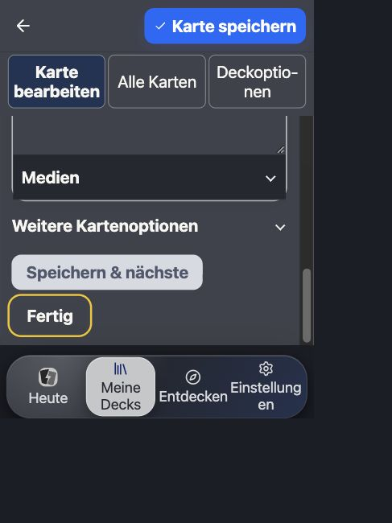

# Weitere UI-Prüfung und Apple-Vorbereitung – 29. Oktober 2026

Status: Die folgenden Browserabläufe, fokussierten Layoutprüfungen und Builds
bestanden. Native Bedienprüfung und Erstnutzertests bleiben **offen**. Keine
Releasefreigabe. Installation und Verteilung übernimmt der Nutzer selbst.

## Weitere Korrekturen

- Kein vorzeitiges „Jetzt lernen“ im Editor eines Decks ohne gespeicherte Karten.
  Vorhandene Referenzinhalte werden als „Nachschlagen“ geöffnet. Die Entscheidung
  verwendet den gespeicherten Gesamtbestand, nicht die gerade geladene Kartenseite.
- Ein leerer Lernplan hat genau einen Einstieg zur Deckauswahl. Der doppelte Link
  zur selben Aufgabe entfällt; bestehende Pläne behalten ihren Verwaltungszugang.
- Lange deutsche Editorbeschriftungen umbrechen bei großer Schrift vollständig.
  Der zunächst beobachtete Überlauf von „Deckoptionen“ ist behoben.
- Die Editorhöhe berücksichtigt die mit der Schrift wachsende Webnavigation.
  Bei 390 × 520 überdeckte die Navigation zunächst 14,13 px des Aktionsbereichs.
  Nach der Korrektur endet dieser bei y=414,65; die Navigation beginnt erst bei
  y=441,14. Der Abstand beträgt 26,49 px. Die Reservierung der nativen Tableiste
  bleibt unverändert.

Die zuvor offenen Arbeiten an Notensatz, Kopieren und Hilfe wurden vollständig
mitgeprüft und auf ausdrücklichen Auftrag `!!!*` mit aufgenommen. Einzelheiten:
[Mac-Kopieren](../../2026-10-25/mac-card-copy.md),
[vereinfachter ABC-Player](../../2026-10-25/abc-without-ab.md),
[kompakte Notenhöhe](../../2026-10-26/compact-music-score-height.md),
[Hilfeaktualisierung](../../2026-10-26/automatic-help-update.md) und
[vollständige Kopiervorlagen](../../2026-10-26/help-copy-complete-fences.md).

## Durchgespielter Browserablauf

Getrennte lokale Prüfbibliothek auf `127.0.0.1:38761`. Keine echten Decks,
Bewertungen oder Cloud-Daten des Nutzers verändert.

1. Deck benannt, erste Frage und Antwort erstellt, „Speichern & fertig“ betätigt.
   Abschluss bestätigt eine gespeicherte Karte und die optionale Planzuordnung.
2. Heute zeigt beim leeren Plan die Auswahlhilfe. Auswahl und Abbrechen kehren
   ohne Zuordnung nach Heute zurück. Erneute Auswahl und Übernehmen führen zum
   regulären Lernstart mit einer Karte.
3. Frage geöffnet, Antwort aufgedeckt, vier Bewertungen samt Intervallen gesehen
   und „Sehr leicht“ bewertet. Abschluss bestätigt eine Wiederholung.
4. App neu geladen: Der abgeschlossene Tagesstand bleibt erhalten. Anschließend
   die Planauswahl bewusst geleert: wieder Auswahlhilfe, keine Fertigmeldung.
5. Einen weiteren leeren Deckeditor geöffnet: kein Lernstart. „Fertig“ ist auch
   mit großer Schrift und geringer Höhe per Tastatur erreichbar.
6. Einstellungen in Deutsch/Englisch und hell/dunkel geprüft. Keine
   Audiooptimierung. Die finale Oberfläche zeigt Version 0.5.2.

[layout.json](layout.json): Sieben gemessene Szenarien bestehen den
Überlappungscheck. Enthalten sind 360 × 844, 390 × 844, 390 × 520 und
1440 × 900 CSS-Pixel. Viewports wurden im DOM kontrolliert. Die finalen
Editorbeschriftungen passen zeilenweise in ihre Buttons; die Dokumentbreite
entspricht jeweils der Viewportbreite. [layout-before.json](layout-before.json)
bewahrt den Befund vor der Höhenkorrektur.

Die normale mobile Lernantwort misst 370 × 688,55 px bei 390 × 844 px Viewport,
mit 14 px Innenabstand und ohne Dokumentscrollen. Der Lernkartencheck besteht.
[contrast.json](contrast.json): Zwölf gerenderte Editorfarbpaare in heller und
dunkler Darstellung bestehen ihre Grenzwerte, kleinstes Verhältnis 4,706:1.
Der globale Scanner meldet null statische Fehler und 326 Review-Stellen; dies
ist keine vollständige Kontrastabnahme der App.

## Automatisierte Prüfung

- Web: **1.057**, API: **313**, Domain: **276**, Plattformpaket: **219**,
  Apple-Hülle: **37**, i18n: **18**, Scheduler: **11**, Sync: **99**.
- Zusätzliche signierte Katalog-/Inhaltsparität: **3**.
- Insgesamt **2.033 unterschiedliche Tests bestanden**. Wiederholte fokussierte
  Läufe werden nicht addiert. Nach der letzten reinen CSS-Korrektur zusätzlich
  36 relevante Editor-, Plan-, Dashboard- und Layouttests bestanden.
- Web-/API-/Apple-Typprüfung, Web-Produktionsbuild, lokaler Apple-Bundle,
  Katalogreproduzierbarkeit und Signaturprüfung, UI-Sprachprüfung und
  Versionsprüfung bestanden. Geänderte Quelldateien formatiert;
  `git diff --check` bestanden.
- Inhalts-, Lern- und Synchronisations-Schutzprüfungen bestanden.
  [integrity.json](integrity.json) bestätigt gegenüber `510b3d09` 54 unveränderte
  geschützte Dateien und 13 unveränderte Methoden/Swift-Bereiche. Die erforderlichen
  Versionsfelder in Paketmanifesten sind davon getrennt. Scheduler und
  Synchronisationslogik wurden nicht geändert.

## iOS-Build für die Übergabe

Produktversion **0.5.2**, Apple-Uploadzähler **5**. Xcode-Projekt:
`apps/apple/ios/App/App.xcodeproj`, Scheme `App`.

Der finale Debug-Gerätebuild mit `generic/platform=iOS` und
`CODE_SIGNING_ALLOWED=NO` besteht. Er kompiliert auch den bereits offenen
Clipboard-Adapter. Bundle im Xcode-Projekt und gebautes `App.app` enthalten
dieselben JS-/CSS-Dateien sowie denselben signierten Katalog; siehe
[apple-bundle.json](apple-bundle.json). Kein Audiowartungsbereich, kein
Optimierungsstarter, kein natives Optimierungsplugin und kein `server.url` zur
Umleitung auf einen alten Webstand. Audiowiedergabe und Legacy-Medien bleiben.

Die Xcode-Vorbereitungsphase baut und kopiert den aktuellen Bundle bei jedem
Build neu. Das geprüfte App liegt lokal unter
`/private/tmp/fnf-ui-final-ios/Build/Products/Debug-iphoneos/App.app`.
Dies ist ein nicht signierter Entwicklungsbuild, kein Distributionsarchiv.
Signierung, Run/Installation und Verteilung bleiben beim Nutzer. Die bestehende
Mac-Installation wurde in diesem Auftrag nicht ersetzt. Kein Push, Upload oder
VPS-Deploy ausgeführt.

## Offene Abnahme

Entsprechend der früheren Rückmeldung bleiben tatsächliches iPhone/iPad/Mac-
WebView, Bildschirmtastatur, VoiceOver, größte native Systemschrift und echter
200-Prozent-Browserzoom offen. Die große App-Schrift ersetzt diese Prüfungen
nicht. Reale Erstnutzertests, vollständige Karten-/Erkunden-Matrix,
native SQLite-Unterbrechung, Backup-Wiederherstellung und Mehrgeräteabgleich
wurden nicht neu abgenommen. Bestehende Integritätstests bestehen; daraus wird
keine neue Cloud- oder Releasefreigabe abgeleitet.

