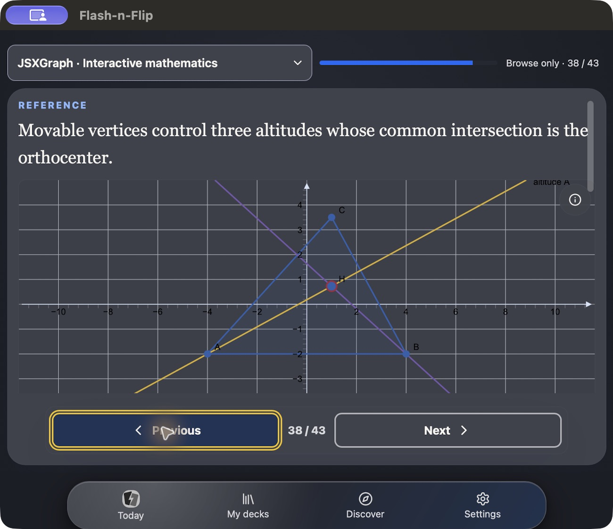

# Mac: zurückbleibender Tastaturstreifen

Stand: 30. Oktober 2026. Auftrag unter `!!`: den leeren Tastaturstreifen in
der kompatiblen iPad-App auf dem Mac beheben. Kein Commit, Push oder Upload.

## Ursache und Korrektur

Der Streifen ist eine native UIKit-Eingabefläche in einem separaten
`UITextEffectsWindow`. Im reproduzierten Fehlerzustand liegt deren Host bei
`y=633`, Höhe 55 pt, innerhalb des 688 pt hohen App-Fensters. Die Webnavigation
wird dadurch überdeckt. Das bloße Leeren der Assistentenbuttons bzw. Entfernen
der Accessory-View beendet diese Eingabesitzung nicht. Auswahl oder Grafikfokus
können sie erneut öffnen, ohne dass sich die Sichtbarkeit von Textfeldern ändert.

Die Korrektur in `SceneDelegate.swift`:

- Eine eigene `WKWebView` entfernt die Form-Accessory nur auf dem Mac über
  den öffentlichen `inputAccessoryView`-Hook und Capacitors WebView-Factory.
  Capacitors erneuter initialer WebView-Fokus entfällt nur auf dem Mac.
- Native Tastaturereignisse und DOM-Fokuswechsel prüfen erneut, ob tatsächlich
  ein sichtbares, bearbeitbares Textfeld aktiv ist. Ohne Texteingabe endet die
  native Sitzung; der vorhandene Bridge-Controller übernimmt die Tastatur.
- Eine laufende DOM-Abfrage, ein inzwischen geänderter Fokus, ein inaktives
  App-Fenster oder ein nativer Dialog dürfen keine gültige Eingabe verdrängen.
  Die Prüfung ist ereignisgesteuert; es gibt keinen zusätzlichen Polling-Timer.
- Die DOM-Auswahl bleibt erhalten. Der Controller reicht Navigationstasten
  wie bisher weiter und unterstützt Cmd+C für ausgewählten Referenztext.
  Ohne Auswahl wird die Zwischenablage nicht überschrieben oder ausgelesen.
- iPhone und iPad behalten das bisherige gebündelte Fokus-/Sichtbarkeitsprotokoll,
  den Systemkeyboard- und Accessory-Pfad sowie den ursprünglichen Initialfokus.

Ein zunächst ausprobierter Ersatz der `inputView` durch eine leere View wurde
verworfen: UIKit erzeugte nach Auswahl und erneutem Eingabefokus einen Fehler
im Mac-Eingabeassistenten. Der finale Code ersetzt die System-Eingabeview nicht
und verwendet keine privaten APIs, Laufzeit-Swizzles oder Klassenname-basiertes
Verstecken von UIKit-Views.

Öffentliche Grundlagen: [Apple inputAccessoryView](https://developer.apple.com/documentation/uikit/uiresponder/inputaccessoryview),
[Apple inputAssistantItem](https://developer.apple.com/documentation/uikit/uiresponder/inputassistantitem)
und [WebKits Accessory-Weiterleitung](https://github.com/WebKit/WebKit/blob/main/Source/WebKit/UIProcess/ios/WKContentViewInteraction.mm).
Die Factory und der Initialfokus wurden zusätzlich gegen die tatsächlich
installierte Capacitor-Version geprüft.

## Native Bedienprüfung

Der finale Stand wurde über Xcode als **My Mac (Designed for iPad)** gebaut
und lokal gestartet. Die zwischenzeitlich wegen Mac-Sperre pausierte
Debugsitzung wurde fortgesetzt und durch den finalen Build ersetzt. Abschließend
läuft die App wieder; der Debugger ist nicht pausiert.

Geprüft im tatsächlichen WKWebView, dunkler Modus, App-Fenster 845 × 688 pt:

1. Bibliothek öffnen, Suchfeld mit der Maus fokussieren, `JSXGraph` mit
   Hardwaretastatur eingeben und die Referenz öffnen.
2. `searchable` im schreibgeschützten Kartentext mit der Maus markieren,
   Cmd+C, über die untere Navigation zurück, Suchfeld fokussieren und Cmd+V.
   Das Feld enthält tatsächlich `searchable`.
3. Im selben Suchfeld erneut tippen und es durch Klick auf die Überschrift
   verlassen. Das weiterhin sichtbare Feld hält keine Eingabesitzung offen.
4. Die vom Nutzer gezeigte Referenz **38/43**, Orthozentrum, öffnen. Punkt C
   verschieben; die Höhen und ihr Schnittpunkt verändern sich. Anschließend
   Text auswählen und die native Eingabegeometrie erneut messen.
5. Über die Referenzbuttons vor/zurück gehen und Referenz 38 wiederherstellen.
   Keine Karten gespeichert, Lernbewertungen abgegeben oder Cloudoptionen geändert.

Die native Geometrie wurde über den Xcode-Debugger mit öffentlichen UIKit-
View-/Window-/Responder-Abfragen gelesen. Bei beiden finalen Messungen liegt
der Input-Host bei **y=688, Höhe 343 pt**, vollständig unter dem App-Fenster.
Die sichtbare Überschneidung beträgt **0 pt**. Der Bridge-Controller ist dabei
automatisch First Responder; kein manueller Debugger-Fokuswechsel wurde für
diese finalen Messungen ausgeführt.

Rohwerte: [nach Suchfeld-Blur](search-blurred-native.txt),
[nach Grafikbedienung und Textauswahl](reference-38-native.txt).
Ein App-Fenster-Screenshot erfasst das separate Tastaturfenster nicht zuverlässig;
die Screenshots allein werden deshalb nicht als Überlappungsnachweis gewertet.

Weitere Nachweise: [verschobener Grafikpunkt](graph-interaction.png),
[erhaltene Auswahl](selection.png), [eingefügter Text](copied-text-search.png),
[AX-Eingabewert](copied-text-search.ax.txt), [gemeldeter Zustand](reported-overlay.png).

## Automatisierte Prüfung und Apple-Vorbereitung

- **45 Apple-Tests bestanden**, darunter ausführbare Tests des injizierten
  Fokusprotokolls für Mac und iPhone/iPad; Swift-Schutzregeln sind ergänzende
  Quelltextprüfungen und ersetzen die native Bedienprüfung nicht.
- Apple-Typecheck bestanden. Unsignierter iOS-Gerätebuild im Scheme
  `TestFlight`, Konfiguration `TestFlight`, Destination `generic/platform=iOS`:
  **BUILD SUCCEEDED**. Der separate lokale Mac-Debuglauf besteht ebenfalls.
- Alle **160 Frontend-Dateien** stimmen zwischen portablem Bundle,
  Xcode-Projekt und gebauter iOS-App überein. Kompilierter Iconkatalog geprüft.
  Details und Quelltext-Hash: [apple-bundle.json](apple-bundle.json).
- Produktversion bleibt **0.5.2**, Apple-Marketingversion **0.5**, technischer
  Uploadzähler **5**. Für einen neuen Upload gelten weiterhin die vorhandenen
  Xcode-/TestFlight-Versionsregeln; dieser Auftrag erhöht keine Version.
- Lesbarkeitsscanner: 0 Fehler, 336 bestehende manuelle Prüfstellen. Dieser
  Fix ändert keine Farben, Schriftgrößen oder Web-Layouts. Die frühere
  Entdecken-/Medien-/Icon-Arbeit bleibt im Arbeitsbaum erhalten.

Diese Abnahme gilt für den beschriebenen Mac-Fehler und die geprüften
Maus-/Tastaturwege. Reale iPhone-/iPad-Bildschirmtastatur, VoiceOver, weitere
macOS-Versionen und allgemeine Store-Freigaben bleiben offen. Ein AXPress auf
ein WebKit-Textfeld ließ während der Untersuchung Apples WebContent-
Accessibility-Code abstürzen; die Bedienprüfung verwendet dafür echte
Mauskoordinaten. Das ist keine bestandene VoiceOver-Abnahme.

Scheduler, Synchronisation und lokale Persistenzregeln bleiben unverändert.
Signieren, Archivieren und Verteilen übernimmt weiterhin der Nutzer.
