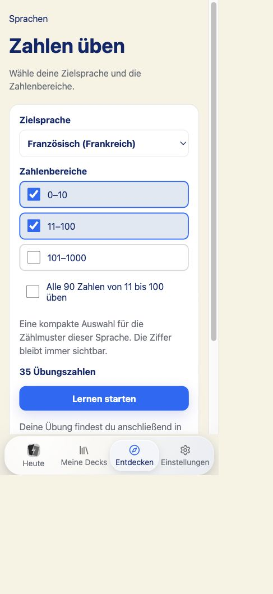

# Zahlen üben: kompakte Einrichtung und feste Lernzahlen

Stand: 31. Oktober 2026. Auftrag unter `!!!*`: die besprochene Vereinfachung
umsetzen, prüfen und alle offenen Änderungen dieses Repositories committen.
Produktversion **0.5.3**, technischer Apple-Build **6**. Kein Push oder Upload.

## Ergebnis

- Entdecken → Sprachen führt bei Zahlen direkt zur Einrichtung. Ein vorhandener
  Sprachfilter wird übernommen. Alte Detailverweise bleiben nutzbar.
- Ein Sprachfeld, drei kombinierbare Bereiche **0–10**, **11–100**,
  **101–1000**, eine Hauptaktion **Lernen starten**. Vorschau, Zahleneingabe,
  Würfeln, Ausgangssprache und Sprachtausch entfallen.
- 0–10 enthält alle elf Zahlen. 11–100 verwendet den kompakten Sprachbestand
  oder ausdrücklich alle 90 Zahlen. Wenn eine Sprache ohnehin alle Zahlwörter
  dieses Bereichs benötigt, entfällt der wirkungslose Zusatzschalter.
- Französisch verwendet exakt die vereinbarte Auswahl: **0–10** sowie
  **11, 12, 13, 14, 15, 16, 17, 20, 21, 22, 30, 40, 50, 60, 70, 71, 72,
  77, 80, 81, 90, 91, 97, 100**. Zusammen sind das **35 Übungszahlen**;
  mit Vollauswahl sind es **101**.
- Für Französisch 101–1000 genügen **12 Beispiele**: 101, 110, 121, 171,
  180, 181, 197, 200, 201, 280, 281 und 1000. Weitere volle Hunderter wiederholen
  das bereits abgedeckte Bildungsschema und werden nicht zusätzlich verlangt.
- Alle 35 angebotenen Sprachen besitzen ein explizites Profil im gemeinsamen
  Domain-Paket. Die Auswahl berücksichtigt die Regeln der vorhandenen,
  gepinnten Zahlwort-Renderer. Hindi/Urdu behalten den Wortbestand bis 100;
  Koreanisch benennt das verwendete sino-koreanische System. Die konkreten
  Werte stehen in [curricula.json](curricula.json).
- Die Frage zeigt die Ziffer, die Antwort dieselbe Ziffer und das Zahlwort.
  Die Ziffer bleibt auch bei anderen Schriftsystemen in vertrauter Schreibweise
  sichtbar. Vorhandene Vorlese-/Hinweisregeln bleiben erhalten.
- Erst nach der dauerhaften lokalen Speicherung öffnet der normale Lernablauf.
  Dessen bestehendes Tageslimit bleibt wirksam: 35 Übungszahlen sind der
  Kartenbestand, keine Zusage über die Größe eines einzelnen Tagesdurchlaufs.
  Fehler behalten die Auswahl und erlauben einen neuen Versuch.

## Fortschritt und Kompatibilität

Es gibt ein verwaltetes Deck je Zielsprache mit einer festen Identität je Zahl.
Die Bewertung von 71 gehört damit dauerhaft zu 71. Beim Verkleinern der Auswahl
werden ausgeschlossene bestehende Karten pausiert; ihre Bewertungen und
Termine bleiben erhalten. Erneutes Einbeziehen nutzt dieselben Karten. Eine
manuell pausierte Karte innerhalb einer unveränderten Auswahl bleibt pausiert.
Die Auswahl wird gemeinsam mit dem Deck in einer lokalen Transaktion gespeichert
und übersteht Export/Wiederherstellung. Ein Gerätehinweis merkt die zuletzt
verwendete Sprache; die gespeicherten Deckdaten bleiben maßgeblich.

Die bisherige v2-Collection wechselte Zahlen unter Kompetenzkarten-IDs. Ihre
Historie wird vollständig erhalten und weder gelöscht noch auf einzelne neue
Zahlen umgedeutet. Diese Collection bleibt getrennt verfügbar. Neue Übungen
verwenden ausschließlich den lokalen v3-Pfad. Die vorhandene API-Kompatibilität
für alte Collections bleibt bestehen.

Scheduler und Synchronisationsverhalten bleiben unverändert. Ein vorhandener
Hash-Helfer in `packages/sync/src/cloud-engine.ts` wurde ausschließlich für den
repositoryweiten Formatcheck formatiert: Vergleich der TypeScript-ASTs vor/nach
der Formatierung identisch; die 99 Sync-Tests bestehen erneut.

Entscheidung: [ADR 0059](../../../../architecture/decisions/0059-fixed-language-number-practice.md).
Weitere Anwendungszahlen dürfen später eigene stabile Karten erhalten; bereits
bewertete Karten wechseln dafür nicht wieder ihren Inhalt.

## Prüfung

| Prüfung                                   | Ergebnis                                                                                                                                                                                                                                                                                     |
| ----------------------------------------- | -------------------------------------------------------------------------------------------------------------------------------------------------------------------------------------------------------------------------------------------------------------------------------------------- |
| Web-Gesamtlauf                            | **1.084 Tests, 192 Dateien bestanden**; danach **22 gezielte UI-Tests** einschließlich der zusätzlich eingeführten Hindi-/Urdu-Schalterregel bestanden. Die gezielten Tests sind keine additive Gesamtzahl.                                                                                  |
| Domain                                    | **350 Tests bestanden**, einschließlich exakter französischer Auswahl, Bereichsgrenzen, Vollauswahl, Ablehnung ungültiger Einstellungen und Rendern aller 35 Sprachprofile.                                                                                                                  |
| Lokale Persistenz                         | Im gezielten Repositorylauf: feste Zahl/Karten-ID, Bewertung, Ablehnung doppelter Review-ID ohne zweite Bewertung, Verkleinern, Erweitern, erneutes Einrichten, frische Repositoryinstanz und Backup-Wiederherstellung bestanden. Alte Collections und andere Zielsprachen bleiben erhalten. |
| Apple / i18n                              | **45 / 18 Tests bestanden**.                                                                                                                                                                                                                                                                 |
| Scheduler / Sync                          | **11 / 99 Tests bestanden**; vorhandene Offline-, Wiederholungs-, Konflikt- und Replay-Semantik bleibt zuständig. Keine neue Cloud- oder Scheduling-Policy.                                                                                                                                  |
| Version / Markenassets / TestFlight-Audit | **11 / 11 / 6 Tests bestanden**; zentrale Versions- und Asset-Prüfung bestanden.                                                                                                                                                                                                             |
| Produktion                                | Abschließender Next.js-Webbuild und unsignierter iOS-Gerätebuild (`TestFlight`, `generic/platform=iOS`) bestanden.                                                                                                                                                                           |
| Apple-Bundle                              | Alle **160 Dateien** stimmen zwischen portablem Bundle, Xcode-Projekt und gebauter App überein. Kompilierter Iconkatalog geprüft. [Audit und Quelltext-Hashes](apple-bundle.json).                                                                                                           |
| Lokalisierung / Inhalt                    | EN/DE/ES/FR-Policy und Projektprüfungen für Lernintegrität, Synchronisation und Inhaltssicherheit bestanden. Neue Karten enthalten ausschließlich vorhandene strukturierte Textblöcke.                                                                                                       |

Realer Browserdurchlauf auf einer getrennten lokalen Prüfbibliothek:
Französisch konfigurieren, 35/101 Umschaltung, leere Auswahl mit gesperrtem Start,
speichern, Frage/Antwort mit Ziffer, bewerten **bei abgeschaltetem HTTP-Testserver**,
Bibliothek erneut öffnen und vollständig neu laden. Der Durchlauf wechselt
offline zu 2/10; nach Neuladen bleiben neun neue Tageskarten. Auswahl und das
eine französische Deck bleiben erhalten. Hindi ohne wirkungslosen Zusatzschalter
und die Versionsanzeige 0.5.3 wurden am abschließenden Bundle geprüft.
Die installierte persönliche Mac-Bibliothek wurde dabei nicht verändert.

Nachweise: [Antwort](answer-dom.txt), [Offline-Bewertung](offline-review-dom.txt),
[erneut geöffnet](reopened-study-dom.txt), [Hindi](hindi-dom.txt).

## Darstellung und Grenzen

Tatsächliche CSS-Viewports **390 × 844**, **390 × 520** und **1440 × 900**;
helle/dunkle Darstellung, normale/größte App-Schrift, leere Auswahl und
Tastaturzugriff auf die Startaktion geprüft. Der bereits bestehende Browserzoom
wurde über die Viewportvorgabe kompensiert; die oben genannten Maße wurden
jeweils aus `innerWidth`/`innerHeight` gelesen. Das ist kein Nachweis für echten
200-Prozent-Browserzoom.

Alle vier gezielten Überlappungsszenarien bestehen; der Dokumentinhalt ist
jeweils nicht breiter als der CSS-Viewport. Auf kurzen Bildschirmen scrollt
die Einrichtung; die vollständig sichtbare Startaktion wird zusätzlich am
Seitenende gegen die mobile Navigation gemessen. 51 gemessene Text-/Hintergrund-
Paare bestehen, kleinster Kontrast **4,706:1**. Die Berechnung berücksichtigt
auch vom Browser gelieferte `color(srgb …)`-Werte. [Messwerte](rendered-measurements.json),
[Kontraste](contrast-results.json). Der Scanner meldet 0 Fehler und 334 manuelle
Prüfstellen im Gesamtprojekt; das ist keine pauschale Freigabe aller Ansichten.

Weitere Ansichten: [kurz, dunkel, große Schrift](setup-short-dark-large.png),
[Desktop dunkel](setup-desktop-dark.png), [Antwort mit Ziffer](answer-mobile.png).

- **Native Bedienprüfung des neuen Zahlenablaufs: offen.** Der Mac war bei
  der Xcode-Bedienprüfung gesperrt. Der erfolgreiche Gerätebuild ersetzt die
  Prüfung im iOS-WebView nicht. Die gestrige native Abnahme des Tastaturrests
  ist ein eigener Nachweis und wird nicht auf diesen neuen Ablauf übertragen.
- VoiceOver, echte iPhone-/iPad-Bildschirmtastatur und echter 200-Prozent-
  Browserzoom: **offen**. Der Browserlauf prüft Maus-/Tastaturbedienung.
- Die Profile bilden die ausgewählten Regeln für **einzelne Kardinalzahlen**
  ab. Fachliche/muttersprachliche Abnahme aller 35 Sprachlehrpläne bleibt offen;
  Tests ersetzen diese nicht. Zählwörter, grammatische Anpassung an Substantive,
  Ordnungszahlen und zusätzliche regionale Systeme sind keine zugesagten Inhalte.
- Öffentliche Freigabe bleibt gesperrt durch die acht bestehenden Gates:
  Produktionslogs/Aufbewahrung, Löschung/Backup alter Daten, netcup-AVV,
  Unternehmensstatus, Steuerkennungen, EU-DSA-Händlerstatus, Minderjährigen-/
  Store-Altersrichtlinie, qualifizierte Prüfung der Rechtstexte.

## Mitgeprüfter Arbeitsbaum

Der `!!!*`-Commit umfasst auch die zuvor offenen Arbeiten: Entdecken-Kategorien
mit sicheren Vorschauen und explizitem Installationsumfang, Korrektur der lokalen
Medienspeicherung, explizite App-Store-/Geräteicons samt Audit und den nativen
Mac-Tastaturfix. Deren frühere Prüfberichte bleiben als datierte Nachweise
erhalten. Es gibt keine Änderungen an anderen Projekten oder Worktrees und
keinen Push, Store-Upload oder VPS-Deploy.
